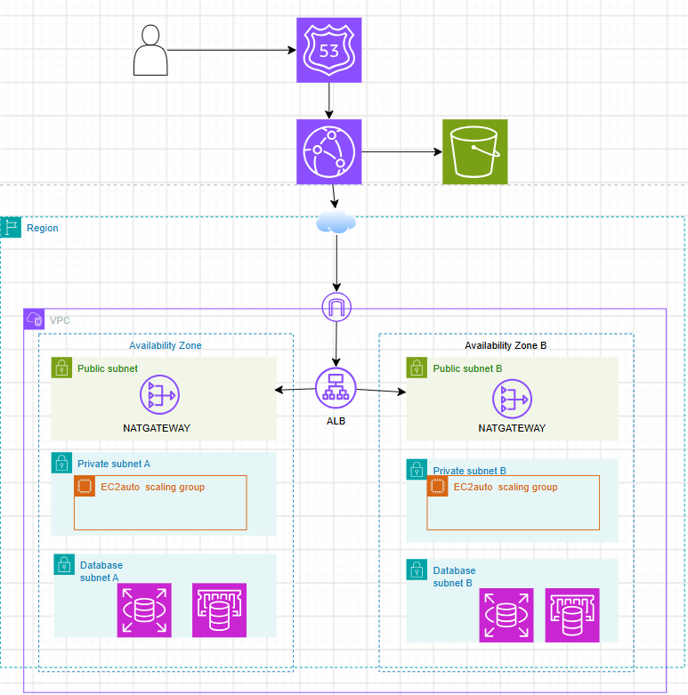

# RetailEdge — AWS Migration Project

Solutions Architect simulation: migrating a mid-size e-commerce company
from 3 bare-metal servers to a Multi-AZ, Three-Tier AWS architecture.

> Hands-on practice project (not a polished client deliverable).
> The Console walkthrough was done in **us-east-1**; the Terraform code was
> tested (`validate` + `plan`) in **eu-west-1**.


## Layer 1 — Architecture Design

Designed a Multi-AZ, three-tier AWS architecture and evaluated
migration strategy per component (Rehost for the web tier, Replatform
for the app tier and the database). TCO analysis projected ~74% cost
reduction over 3 years compared to the current on-premises setup.

Full details: [layer-1-design/console-steps.md](./layer-1-design/console-steps.md)

---

## Layer 2 — Network Foundation & Security

Built a VPC (10.0.0.0/16) with 6 subnets across 2 Availability Zones,
an Internet Gateway, 2 NAT Gateways, and 4 route tables enforcing
strict tier isolation (public, private, database). Created 4 security groups (alb-sg → app-sg → rds-sg / cache-sg) so each tier only
accepts traffic from the tier directly in front of it.

Full details: [layer-2-network/console-steps.md](./layer-2-network/console-steps.md)

## Layer 3 — Compute & Auto Scaling

Built a Launch Template, Application Load Balancer, Target Group,
and Auto Scaling Group (min=2, max=10) serving a PHP application on
port 8080 behind the ALB on port 80. Configured a target tracking
scaling policy (60% CPU) and a scheduled scaling action for Friday
evenings, then verified the site serves traffic correctly through
the ALB.

Full details: [layer-3-compute/console-steps.md](./layer-3-compute/console-steps.md)

## Layer 4 — Data Layer & Migration

Provisioned RDS MySQL Multi-AZ (`retailedge-db`) with encrypted
storage and 7-day backups, plus an ElastiCache Redis cluster
(`retailedge-cache`) with 2 nodes, Multi-AZ and encryption at rest
and in transit. Wrote a 4-phase migration cutover plan (Full Load,
CDC, Cutover, Rollback) achieving near-zero RPO and under 2-minute RTO.

Full details: [layer-4-data/console-steps.md](./layer-4-data/console-steps.md) | [Migration Plan](./layer-4-data/migration_plan.md)

## Layer 5 — CI/CD Pipeline & Go-Live

Containerized the application with Docker and built a GitHub
Actions workflow (test → build → deploy). The workflow is
**manually triggered** (`workflow_dispatch`): there is no AWS OIDC
role set up, so the deploy and rollback steps are **designed and
documented, not provisioned** (the commands are commented out).
Wrote a Go-Live checklist and a safe DNS cutover plan using
Route 53 weighted routing.

### CloudWatch Alarms

Alarms created in the Console vs. designed only:

| Alarm | Metric | Threshold | Status |
|-------|--------|-----------|--------|
| Unhealthy Hosts | ALB UnHealthyHostCount | > 0 | Created |
| High Latency | ALB TargetResponseTime | > 0.8s | Created |
| DB CPU Spike | RDS CPUUtilization | > 80% | Created |
| High Error Rate | ALB 5xx rate | > 1% | Designed (no 5xx data points yet) |
| Low Cache Hit Rate | ElastiCache hit rate (Metric Math: CacheHits / (CacheHits + CacheMisses)) | < 70% | Designed (needs Metric Math) |

All alarms notify via a shared SNS topic.

Full details: [layer-5-cicd/console-steps.md](./layer-5-cicd/console-steps.md)

---

## Terraform (Infrastructure as Code)

Terraform code lives in [`Terraform/`](./Terraform) (region `eu-west-1`).
Only `terraform validate` and `terraform plan` were run
(**no full `apply`**; apply was only tried once on VPC + subnet to test).


```
Terraform/
├── provider.tf, main.tf, variables.tf, terraform.tfvars
└── modules/
    ├── Network   # VPC, 6 subnets, IGW, 2 NAT, route tables, alb/app/db SGs
    ├── Compute   # Launch Template, ALB, Target Group, ASG, scaling
    └── Data      # RDS MySQL Multi-AZ, ElastiCache Redis (2 nodes, Multi-AZ)
```

Latest result: `Plan: 39 to add, 0 to change, 0 to destroy.`

Notes:
- `alb_sg` allows inbound 80 and 443 (the ALB listener is HTTP; no ACM
  certificate in this practice setup).
- Compute includes Target Tracking (60% CPU) and a scheduled action
  (desired capacity = 6 every Friday 20:00 UTC).
- ElastiCache runs with Multi-AZ and automatic failover enabled
  (`multi_az_enabled` + `automatic_failover_enabled`).
- RDS master password is managed by AWS Secrets Manager
  (`manage_master_user_password = true`), so no password is stored in code.
## Known Limitations

This is a hands-on practice project, not a production deployment. The gaps
below were found during a self-review and are documented on purpose.

**Infrastructure as Code**
- The ElastiCache replication group in Terraform is not attached to a
  dedicated `cache-sg` (port 6379 from `app-sg`). This was fixed only in the
  Console (see layer-2 "Design Correction"). If the Terraform code were
  applied as-is, the cache would use the VPC default security group and the
  application tier could not reach it.
- Terraform state is local (no S3 backend / state locking). A real
  environment would use a remote backend.
- `skip_final_snapshot = true` and no `deletion_protection` on RDS, because
  the stack was torn down between sessions to control cost.
- No IAM instance profile for the EC2 instances (no Secrets Manager read
  access for the RDS password, no SSM Session Manager). Out of scope.
- Ports are partly hard-coded in the Network module (8080 / 80 / 443)
  instead of using the `app_port` / `alb_port` variables.
- `terraform apply` was never run on the full stack; only `validate` and
  `plan` (39 resources).

**Security**
- The ALB listens on HTTP only (no domain / ACM certificate in this
  practice setup). Port 443 is open in `alb-sg` but unused.
- ElastiCache has encryption in transit but no AUTH token / user group, and
  no snapshot retention.

**CI/CD**
- The GitHub Actions workflow is manual (`workflow_dispatch`). The OIDC role
  is a placeholder, and there is no application code (`index.php`), so the
  `test` job would fail if run.
- The Docker image is not what the Auto Scaling Group runs: instances are
  configured through the Launch Template user data. The pipeline and the
  compute layer are designed but not wired together.
- The deploy and rollback commands are commented out.

**Design / Documentation**
- The TCO (~74% saving) is an infrastructure-only estimate based on larger
  instance sizes than the t3.micro used in the lab; it excludes data
  transfer, NAT data processing, DMS, and monitoring costs.
- The migration plan is a high-level cutover design. It does not cover DMS
  prerequisites (binlog settings, connectivity from on-premises), data
  validation, or reverse replication for rollback.
- Route 53, CloudFront, and S3 appear in the architecture diagram as part
  of the target design but were not built.
